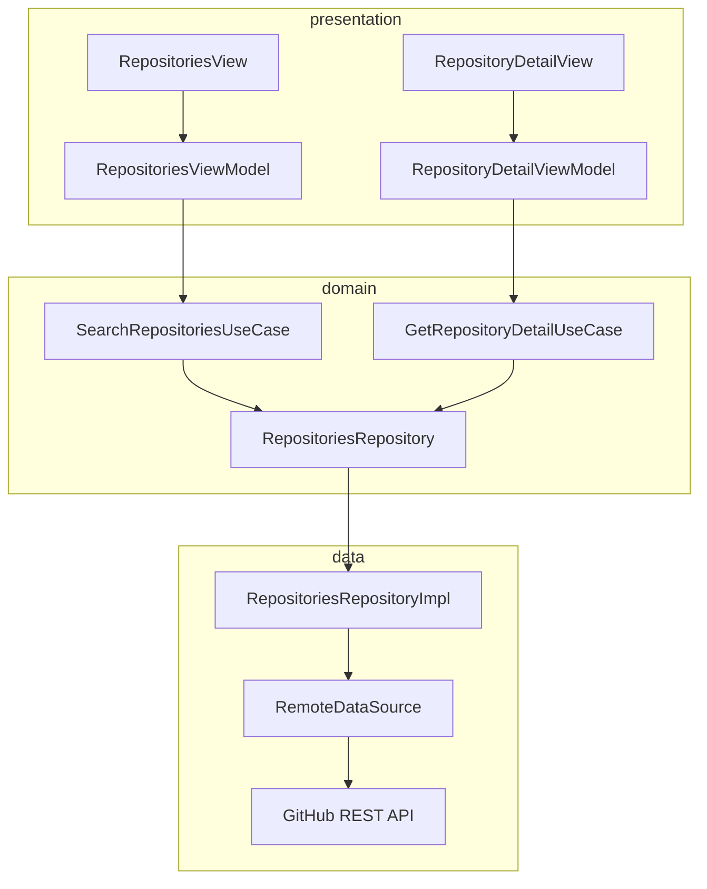

# App GitHub

Flutter client for browsing GitHub repositories through the GitHub Search API, with a UI inspired by GitHub's Primer design system.

Supports debounced search, language filters, sorting (best match, stars, forks, recently updated) with ascending/descending order, and infinite scroll pagination.

Domain use cases build search queries and validate input; repositories map API pages and propagate `ResultPattern` outcomes.

Presentation uses view models built on a lightweight `StateManagement` (`ChangeNotifier`) with `StatePattern` for loading, success, and error UI states.

Includes layered tests (models, data sources, repositories, use cases, view models) and CI with analyze and coverage.

## Structure



## Stack

| Technology | Version |
|------------|---------|
| Dart SDK | ^3.13.5 |
| connectivity_plus | ^7.1.1 |
| cupertino_icons | ^1.0.8 |
| dio | ^5.11.1 |
| get_it | ^9.3.0 |
| go_router | ^18.0.2 |
| flutter_lints | ^6.0.0 |
| build_runner | ^2.16.2 |
| mockito | ^5.8.1 |
| Android Gradle Plugin | 9.1.0 |
| Kotlin | 2.4.0 |
| NDK | 30.0.16248370 |
| compileSdk / targetSdk | 36 |
| minSdk | 29 |
| JVM | 25 |
| iOS Deployment Target | 15.0 |
| Swift | 5.0 |
| GitHub Actions | CI/CD |

## Architecture

```
lib/
    ├── main.dart
    └── src/
        ├── common/
        │   ├── constants/
        │   ├── dependency_injectors/
        │   ├── design/
        │   ├── enums/
        │   ├── patterns/
        │   ├── routes/
        │   ├── services/
        │   ├── state_management/
        │   ├── utils/
        │   └── widgets/
        └── features/
            └── repositories/
                ├── data/
                │   ├── data_sources/
                │   ├── models/
                │   └── repositories/
                ├── domain/
                │   ├── entities/
                │   ├── exceptions/
                │   ├── repositories/
                │   └── use_cases/
                └── presentation/
                    ├── routes/
                    ├── view_models/
                    ├── views/
                    └── widgets/
```

## Coverage

flutter pub run build_runner build --delete-conflicting-outputs

flutter test --coverage

genhtml coverage/lcov.info -o coverage/html

open coverage/html/index.html

## ScreenShots

| Image 1 | Image 2 | Image 3 |
|----------|----------|----------|
|  |  |  |

## Commits

```
git add . && git commit -m ":rocket: Initial commit." && git push
git add . && git commit -m ":building_construction: Added initial project architecture." && git push
git add . && git commit -m ":building_construction: Update project architecture." && git push
git add . && git commit -m ":memo: Updated project documentation." && git push
git add . && git commit -m ":memo: Updated code documentation." && git push
git add . && git commit -m ":white_check_mark: Added feature xyz." && git push
git add . && git commit -m ":wrench: Fixed xyz usage." && git push
git add . && git commit -m ":heavy_minus_sign: Removed xyz." && git push
git add . && git commit -m ":memo: Adjusted project imports." && git push
git add . && git commit -m ":arrow_up: Updated dependencies." && git push
git add . && git commit -m ":arrow_down: Removed dependencies." && git push
git add . && git commit -m ":wastebasket: Removed unused code." && git push
git add . && git commit -m ":test_tube: Added test functionality xyz." && git push
git add . && git commit -m ":construction_worker: Building in progress." && git push
git add . && git commit -m ":construction_worker: Added CI build system." && git push
```

## License

MIT License

Copyright (c) 2026 William Franco

Permission is hereby granted, free of charge, to any person obtaining a copy
of this software and associated documentation files (the "Software"), to deal
in the Software without restriction, including without limitation the rights
to use, copy, modify, merge, publish, distribute, sublicense, and/or sell
copies of the Software, and to permit persons to whom the Software is
furnished to do so, subject to the following conditions:

The above copyright notice and this permission notice shall be included in all
copies or substantial portions of the Software.

THE SOFTWARE IS PROVIDED "AS IS", WITHOUT WARRANTY OF ANY KIND, EXPRESS OR
IMPLIED, INCLUDING BUT NOT LIMITED TO THE WARRANTIES OF MERCHANTABILITY,
FITNESS FOR A PARTICULAR PURPOSE AND NONINFRINGEMENT. IN NO EVENT SHALL THE
AUTHORS OR COPYRIGHT HOLDERS BE LIABLE FOR ANY CLAIM, DAMAGES OR OTHER
LIABILITY, WHETHER IN AN ACTION OF CONTRACT, TORT OR OTHERWISE, ARISING FROM,
OUT OF OR IN CONNECTION WITH THE SOFTWARE OR THE USE OR OTHER DEALINGS IN THE
SOFTWARE.
